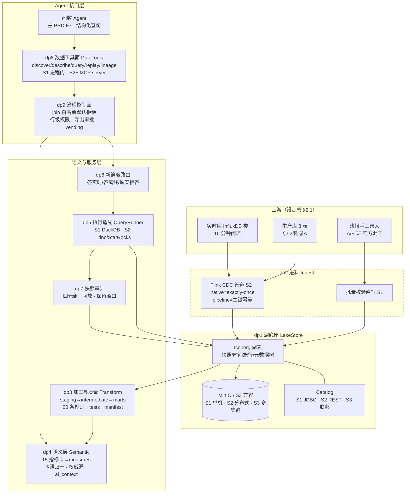

# DataAgent 数据面架构图 v1

> 阶段 2 产出 · 来源: specs/data-plane/modules.md（卡是唯一真源，图是投影）· 状态: **待用户过审**（PRD §9 决策 7：自主档先行，追认位待补）
> 图例：实线=数据/调用流；三档差异用注记标出（S1 关停件用虚线框表示"该档不存在"）。

> 注：S1 档 CDC/实时库一侧不存在（虚线区），批量校验直写是唯一进料；dp8 退化为进程内函数。S3 档在图上叠加：多湖多目录联邦（dp1）、dbt 多项目（dp3）、Cube 联邦（dp4）、多引擎（dp5）、MCP server 池（dp8）、策略引擎+credential vending（dp9）——接口全部不变，只换适配器（specs/data-plane/modules.md 规模映射矩阵）。

## 过审记录

- 状态：**待用户追认**（自主档授权下先行，见 docs/prd-data-plane.md §9 决策 7）。
- 追认后补记：日期 / 结论 / 修改落点 / 遗留问题（格式沿 sdd-flow ADR 惯例，落 `docs/adr/`）。
